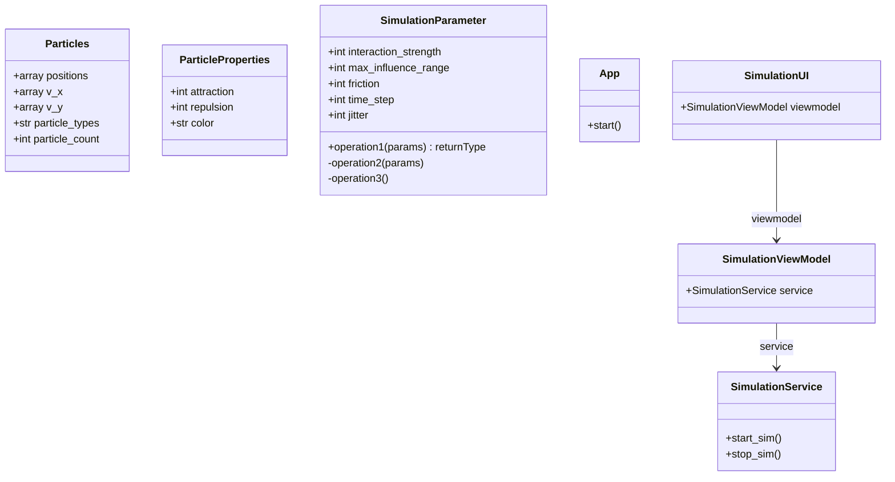

# Architektur

## Klassendiagramm

## Komponentenübersicht

### `Particles`

Verwaltet den Zustand und die Bewegungsdaten der Partikel in der Simulation.

- **Attribute:**
  - `positions` (`array`)
  - `v_x` (`array`)
  - `v_y` (`array`)
  - `particle_types` (`str`)
  - `particle_count` (`int`)

### `ParticleProperties`

Definiert die physikalischen und visuellen Eigenschaften eines Partikeltyps.

- **Attribute:**
  - `attraction` (`int`)
  - `repulsion` (`int`)
  - `color` (`str`)

### `SimulationParameter`

Konfigurationsparameter für die physikalische Berechnung der Simulation.

- **Attribute:**
  - `interaction_strength` (`int`) — *Interaktionsstärke*
  - `max_influence_range` (`int`) — *max. Einflussreichweite*
  - `friction` (`int`) — *Reibung/Dämpfung*
  - `time_step` (`int`) — *Zeitschritt*
  - `jitter` (`int`) — *Zusatzbewegung*
- **Methoden:**
  - `+ operation1(params): returnType`
  - `- operation2(params)`
  - `- operation3()`

### `SimulationService`

Steuert den Lebenszyklus und die Ausführung der Simulation.

- **Methoden:**
  - `+ start_sim()`
  - `+ stop_sim()`

### `SimulationViewModel`

Bindeglied zwischen der Benutzeroberfläche (`SimulationUI`) und der Simulationslogik (`SimulationService`).

- **Attribute:**
  - `service` (`SimulationService`)

### `SimulationUI`

Repräsentiert die Benutzeroberfläche der Simulation.

- **Attribute:**
  - `viewmodel` (`SimulationViewModel`)

### `App`

Einstiegspunkt der Anwendung.

- **Methoden:**
  - `start()`
